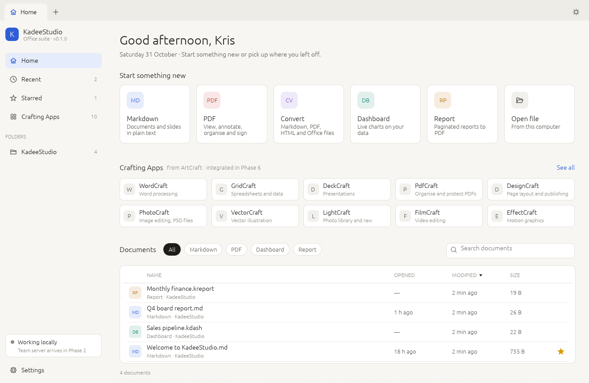
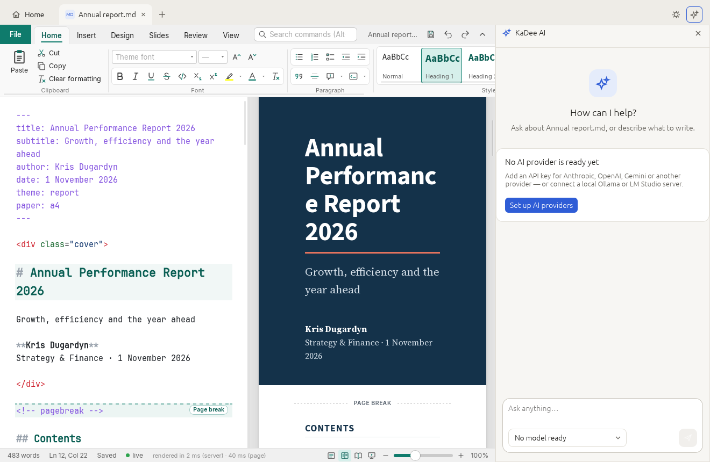

# KadeeStudio

A native Rust office suite with KaDee AI, Markdown, PDF, conversion, dashboards and reports, and real-time collaboration through a self-hosted server on Docker or Kubernetes. It will also host the Crafting Apps: thirteen ArtCraft apps and SolidCraft.

**Status — v0.3.0, Phase 2: Kadee Markdown.** Markdown files now open in a full editor: mdcraft's word processor for Markdown, inside the Markdown tab, with KaDee AI beside it. The other editors and the collaboration server come in later phases.





## Kadee Markdown (new in 0.3.0)

Kadee Markdown is [mdcraft](https://github.com/kdugardyn66/mdcraft-main), the Markdown word processor, built into KadeeStudio. Every `.md`, `.markdown`, `.mdd` and `.mds` file opens in it, in its own tab:

- **Ribbon**: Home (clipboard, font and size, highlight and font colour, paragraph, the live **Styles** gallery), Insert (cover page, page break, contents, tables, pictures, diagrams, charts, media, chemistry, links, footnotes, callouts, code, equations, date, emoji, symbols), Design (document themes and fonts, paper size, orientation, margins, watermark, numbered headings), Slides (layouts, slide themes, notes, background, present, convert a document to slides), Review (spelling, word count, accessibility check), View (write / split / read, navigation pane, zoom, light or dark interface, dark page, focus mode) and the contextual Table tab. Command search: **Alt+Q**.
- **Editor and preview**: Markdown highlighting, smart lists, search and replace, spell-check; the preview follows as you type and scrolls with the cursor; double-click a block in the preview to edit it. Mermaid, Graphviz, PlantUML, Vega, Chart.js, Plotly, KaTeX/MathJax with chemistry, CSV tables, `@import`, code chunks, pictures (HEIC too), videos and 3D molecules, all bundled so they work offline.
- **Slides**: decks with layouts, themes, speaker notes and a full-screen slide show (**F5**; N notes, B black screen).
- **File** view: templates (11 Word-style documents, 8 PowerPoint-style decks), **My templates** (your own `.mdd` and `.mds` files, kept in KadeeStudio's `Templates` folder), Open, Save As, document properties, print, export to PDF, a web page or formatted text, and Options.
- **Safety**: unsaved documents are kept for recovery after a crash; closing a tab or KadeeStudio asks about unsaved changes; files are written atomically.

How it fits in KadeeStudio:

- New documents and Open/Save start in your KadeeStudio documents folder; a template opened while a document is open gets its own tab, and the tab follows Save As.
- KadeeStudio's shortcuts keep working while you type: Cmd+W closes the tab, Ctrl+Tab switches tabs, Cmd+N opens the New document menu, Cmd+J the KaDee AI pane. Every other key goes to the editor (Cmd+B bold, Cmd+S save …). On macOS the Edit menu (Undo, Cut, Copy, Paste, Select All) works in the editor.
- **KaDee AI is the assistant.** mdcraft's own AI parts (its MCP server and the agent bridge) are not included. The KaDee AI pane next to a Markdown tab reads the editor's current text, unsaved edits included, and every answer has **Insert into document**, which puts it at the cursor as one undoable edit.
- mdcraft's settings, recent files and recovery copies live in `Markdown` next to `home.json`.
- Kadee Markdown runs on **macOS and Linux**. On Linux it needs WebKitGTK 4.1 and runs on X11 (XWayland on a Wayland desktop; KadeeStudio switches to it itself). On Windows, Markdown files still open in the file tab with *Open in default app*.

How it is built: `crates/mdcraft-core` (mdcraft's renderer and editor server, with its web interface) and `crates/mdcraft-templates` are mdcraft's crates without the AI code; `apps/kadeestudio/src/markdown.rs` runs one mdcraft core per tab and shows its page in a web view (wry: WKWebView on macOS, WebKitGTK on Linux) laid over the tab, answering the page's requests (dialogs, printing, full screen, new tabs, closing) the way mdcraft's own window does.

## KaDee AI (since 0.2.0)

KaDee AI is the assistant in KadeeStudio. It is built the way SolarOffice's AI is: one layer (`crates/kadee-ai`) over many providers, with the settings in `ai.toml` next to `home.json`.

- **Providers**: Anthropic (Claude), Google Gemini, OpenAI, Mistral, DeepSeek, Alibaba Qwen, Moonshot Kimi, Z.AI GLM, Cohere, Meta, Microsoft Foundry, SpaceX AI Grok, Aleph Alpha and Sakana; local **Ollama** and **LM Studio**; any OpenAI-compatible endpoint (vLLM, llama.cpp, OpenRouter, Groq …) and custom providers; DeepL and FLUX are known to the layer for later. Settings › **AI providers** groups them by region, shows *Needs an API key* or *Local · no key needed*, and has **Test connection**.
- **Models**: Settings › **AI models** sets the default model and one model per part of KadeeStudio (start screen, Markdown, PDF, Dashboards, Reports, Word, spreadsheets, presentations). Prices and limits come from a built-in catalogue; you can add models the catalogue does not list.
- **Chat**: sidebar › **KaDee AI** (`Cmd+Shift+A`). Answers stream in; **Stop**, **New chat**, a model picker, *General chat* or *For* a module, and an optional *Starred files* context. Each answer shows its tokens and cost.
- **AI pane**: the ✦ button in the tab strip (`Cmd+J`) opens KaDee AI next to the open file. It knows the file (its text, when it is readable) and uses that module's instructions and model.
- **Private by default**: nothing is sent anywhere until you add a provider. API keys are stored in `ai.toml` in plain text, readable by you only, or read from the provider's usual environment variable (`ANTHROPIC_API_KEY` …). AI changes in Settings are kept when you click Done and dropped on Cancel.

## The start screen

- **Tab strip**: a Home tab, one tab per opened file (middle-click or × to close), a **+** menu for new documents (Markdown, PDF, dashboard, report, Word, spreadsheet, slide deck), and a theme switch (System → Light → Dark).
- **Sidebar**: Home, Recent, Starred, Crafting Apps, the KadeeStudio documents folder, a collaboration status card, Settings.
- **Greeting** with your name and today's date.
- **Quick-start tiles** for Markdown, PDF, Dashboard and Report, plus *Open file*. Markdown, Dashboard and Report create a new file in `~/Documents/KadeeStudio` and open it in a tab; PDF opens a PDF. Convert has no tile; it will live under File › Convert and the right-click menu.
- **Crafting Apps**: the start screen shows the Crafting Apps that are installed on this computer, each with its own icon; click one to open it. The Crafting Apps page lists all fourteen alphabetically (CADCraft, DeckCraft, DesignCraft, EffectCraft, FigCraft, FilmCraft, GridCraft, LightCraft, PdfCraft, PhotoCraft, SolidCraft (Tangency Labs), SoundCraft, VectorCraft, WordCraft) with *Installed · version* or *Not installed*. They are found the way the ArtCraft launcher finds them: the launcher's own record, `<App>.app` in `/Applications` or `~/Applications` on macOS, `Program Files` on Windows, and AppImages, packages on `PATH` and Flatpaks on Linux. Embedding comes in Phase 7.
- **Documents table**: filter pills All, Office, Markdown, PDF, Dashboard, Report, Graphics, Media and CAD. **All** includes every file type KadeeStudio or a Crafting App opens (`.docx`, `.xlsx`, `.pptx`, `.psd`, `.svg`, raw photos, audio, video, `.fig`, `.dwg`, `.step`, `.stl` …; the registry is `crates/kadee-core/src/doctype.rs` and `craft.rs`), and each row says which app opens it. Search, sortable Name / Opened / Modified / Size, star on hover, right-click menu (Open, Open in default app, Show in folder, Copy path, Star, Remove from Recent); missing files are marked.
- **File tab**: Markdown files open in Kadee Markdown; other files show their details and the app that will open them, with *Open in default app*, *Show in folder* and *Star*, until their editors exist.
- **Settings** is a popup (the gear in the sidebar, ⌘, / Ctrl+,) with **General** (theme, your name, documents folder), **Keyboard** (the shortcut editor) and **About**. Changes show at once; **Done** keeps them, **Cancel**, × or Esc puts back what was there.
- **About** has the logo, version, build (commit and date), system, renderer, settings path, the installed Crafting Apps, credits and license, plus *Copy version info*, *Source code* (the GitHub repository), and buttons for the documents, settings and templates folders. Your own templates go in `Templates` next to `home.json` (`~/Library/Application Support/be.Kadee.KadeeStudio/Templates` on macOS). On macOS the menu bar follows ONLYOFFICE's: **KadeeStudio** (About, Check for Updates…, Settings…, Services, Hide, Quit), **File** (New document…, New ▸ every document type, Open…, Close; Save, Save As… and Print… are greyed out until the editors arrive), **Edit** (Undo, Redo, Cut, Copy, Paste, Select All), **Window** and **Help** (Acknowledgments, License Agreement, KadeeStudio Help). Menu items show the shortcuts from your key map: one-key shortcuts such as ⌘O appear, sequences such as ⌘N M do not. About and Acknowledgments open this same page; Check for Updates… opens the project's releases page.
- First launch creates `~/Documents/KadeeStudio` with *Welcome to KadeeStudio.md*.
- State is saved in `home.json` in the platform config folder; `KADEE_CONFIG_DIR` overrides it.

### Keyboard shortcuts

KadeeStudio uses the four modifier keys of the system it runs on, each as a separate key:

| System | Modifier keys | Main shortcut key |
| --- | --- | --- |
| macOS | Cmd, Ctrl, Option, Shift | Cmd |
| Windows | Win, Ctrl, Alt, Shift | Ctrl |
| Linux | Super, Ctrl, Alt, Shift | Ctrl |

On a Mac, Cmd+N and Ctrl+N are different shortcuts. Shortcuts are saved with the main key written as `Primary`, so a `Cmd+N` made on a Mac becomes `Ctrl+N` when the settings are used on Windows or Linux. Windows keeps most Win+letter combinations for itself. The table below shows the Mac names; on Windows and Linux read Ctrl for Cmd.

| Keys | Action |
| --- | --- |
| Cmd+N | New document menu, opens at once |
| Cmd+N then M / P / D / R | New Markdown document / PDF / dashboard / report |
| Cmd+N then W / G / S | New Word document (.docx) / spreadsheet (.xlsx) / slide deck (.pptx) |
| Cmd+Shift+D / Cmd+Shift+R | New dashboard / new report |
| Cmd+O | Open a file |
| Cmd+W, Cmd+Shift+T | Close tab, reopen closed tab |
| Ctrl+Tab, Ctrl+Shift+Tab | Next / previous tab (Control on macOS too) |
| Cmd+1 … Cmd+9 | Home, tab 2–9 |
| Cmd+, | Settings |

**New document menu.** Cmd+N (Ctrl+N on Windows and Linux) opens the menu right away. Each tile shows its letter: M Markdown, P PDF, D Dashboard, R Report, W Word, G spreadsheet (grid), S slide deck. Press the letter, click a tile, or Esc to close. Typing Cmd+N M quickly works the same way. Word, spreadsheet and slide deck files are blank `.docx`, `.xlsx` and `.pptx` files that WordCraft, GridCraft and DeckCraft will open. The letters are ordinary shortcuts (`Cmd+N M` …), so you can change them or add your own on the Keyboard shortcuts page.

**Settings › Keyboard** is the shortcut editor. Click **Record** and press the keys; they appear as you type (`Cmd+N`). Shortcuts can be **sequences**: press `Cmd+N`, then `M`, and the shortcut reads `Cmd+N M`. When the first keys of a sequence also have a shortcut of their own (`Cmd+N`), KadeeStudio waits one second for the next key and shows what can follow. Enter saves a recording at once, Esc cancels, Backspace starts over. **Add a shortcut** binds any action (several shortcuts per action are fine), a warning shows when two shortcuts use the same keys, and **Reset to defaults** brings back the list above. Shortcuts are saved in `home.json`.

## Build and run

Needs Rust 1.88 or newer. On Linux, the build needs the usual GUI development packages (listed under Linux below).

```sh
cargo run -p kadeestudio                     # the app
cargo run -p kadeestudio -- notes.md a.pdf   # open files in tabs
cargo run -p kadeestudio -- --page=about     # start on a page (recent, starred, craft, folder) or in Settings (settings, keyboard, about)
cargo run -p kadeestudio --features glow     # OpenGL renderer (old GPUs, VMs)
cargo test --workspace
cargo clippy --workspace --all-targets
```

A screenshot of the first frame for docs or CI:

```sh
EFRAME_SCREENSHOT_TO=home.png cargo run -p kadeestudio --features screenshot
```

## Build installers

`./build.sh` picks the script for the OS you are on; everything lands in `dist/`.

### macOS (`scripts/build-macos.sh`)

Needs Rust and the Xcode command line tools (`xcode-select --install`).

```sh
./scripts/build-macos.sh               # this Mac's architecture → dist/KadeeStudio.app + .dmg
./scripts/build-macos.sh --run         # build the .app and open it
./scripts/build-macos.sh --universal   # Apple silicon + Intel in one binary
./scripts/build-macos.sh --no-dmg      # .app only
```

- The .app gets an Info.plist (bundle id `be.kadee.KadeeStudio`, macOS 11 or newer) and the icon from `assets/app-icon`.
- The .dmg is made with `diskutil image` on macOS 26 and newer, where hdiutil is deprecated, and with hdiutil on older systems (the same flow as mdcraft). Finder lays out the window with the background from `packaging/macos`; allow Terminal to control Finder when macOS asks, or use `DMG_LAYOUT=0` for a plain .dmg.
- Without a certificate the app is ad-hoc signed: it runs on the Mac that built it. To distribute, sign and notarize:

```sh
xcrun notarytool store-credentials kadee-notary --apple-id you@example.com --team-id TEAMID
APPLE_SIGNING_IDENTITY="Developer ID Application: Your Name (TEAMID)" \
APPLE_NOTARY_PROFILE=kadee-notary ./scripts/build-macos.sh --universal
```

### Linux (`scripts/build-linux.sh`)

```sh
sudo apt install build-essential pkg-config libxkbcommon-dev libwayland-dev libx11-dev \
  libxcursor-dev libxrandr-dev libxi-dev libgl1-mesa-dev libgtk-3-dev \
  libwebkit2gtk-4.1-dev                                                   # Debian / Ubuntu
./scripts/build-linux.sh               # .tar.gz with install.sh, plus .deb / .rpm / AppImage
```

A .deb is made when `dpkg-deb` is present, an .rpm when `rpmbuild` is, an AppImage when `appimagetool` is. Fedora packages are in the script's header.

### Windows (`scripts/build-windows.ps1`)

Needs Rust with the MSVC toolchain and Visual Studio Build Tools (C++ workload).

```powershell
.\scripts\build-windows.ps1              # x64 → portable .zip
.\scripts\build-windows.ps1 -Msi         # also an .msi (dotnet tool install --global wix)
.\scripts\build-windows.ps1 -Arch arm64
```

### Without your own machines

The **Release** workflow (`.github/workflows/release.yml`) builds the macOS .dmg (universal), the Linux .tar.gz, .deb, .rpm and AppImage, and the Windows .zip and .msi on GitHub's runners. Start it from Actions → Release → Run workflow, or push a tag such as `v0.2.0` to publish a GitHub release.

## Layout

```
apps/kadeestudio/        the desktop app (egui / eframe)
  src/main.rs            window, app icon, renderer choice
  src/app.rs             state, the command runner
  src/icons.rs           line icons painted in code
  src/ui/                tab strip + sidebar (mod.rs), home, file table, Crafting Apps page, Settings popup (settings.rs), file tab
  src/mac_menu.rs       macOS menu bar (About opens Settings › About)
  assets/craft-icons/    the Crafting Apps' own icons
crates/kadee-ai/         KaDee AI: providers, models and prices, streaming requests, chat state (no UI)
crates/kadee-core/       modules, Crafting Apps catalogue and installed-app detection, file-type registry, Recent/Starred, settings, home.json, file helpers (no UI)
crates/kadee-ui/         design tokens, light/dark palettes, badges, pills, buttons
crates/kadee-commands/   every action as a Command with a stable id; key map, chords and sequences, matcher
scripts/                 build-macos.sh, build-linux.sh, build-windows.ps1
packaging/               macOS dmg background, Linux .desktop + AppStream, Windows MSI (WiX)
assets/app-icon/         logo (kadeestudio.svg is the master) as PNG, .icns and .ico
```

Rules: `kadee-core` never depends on egui, and every click or shortcut becomes a `Command` that runs in one place (`app.rs`). This keeps the door open for a command palette, CLI, MCP and AI later.

## Roadmap

| Phase | Deliverable |
| --- | --- |
| 0 | Workspace, shell, start screen (0.1.0) |
| 1 | KaDee AI: providers and models, chat, an AI pane per tab (0.2.0, this release); next: tools as commands, MCP server |
| 2 | Kadee Markdown — port of mdcraft to a native editor |
| 3 | Collaboration: Yrs CRDT sync server (Axum, PostgreSQL, NATS, S3), Docker Compose and Helm chart, OIDC |
| 4 | Kadee PDF |
| 5 | Kadee Convert |
| 6 | Kadee Dashboards and Reports (DataFusion) |
| 7 | Crafting Apps (ArtCraft and SolidCraft): launch, file hand-off, embedded engines |

The full architecture and implementation plan is in the KadeeStudio plan document.

## License

MIT OR Apache-2.0. KaDee AI is derived from the SolarOffice AI layer (`solar-ai`) by the same author. The Crafting App names and icons belong to the ArtCraft team, Tangency Labs and each app's contributors; KadeeStudio lists them and shows their icons, copied unmodified from the ArtCraft launcher (MIT OR Apache-2.0, see `apps/kadeestudio/assets/craft-icons/ATTRIBUTION.md`).
